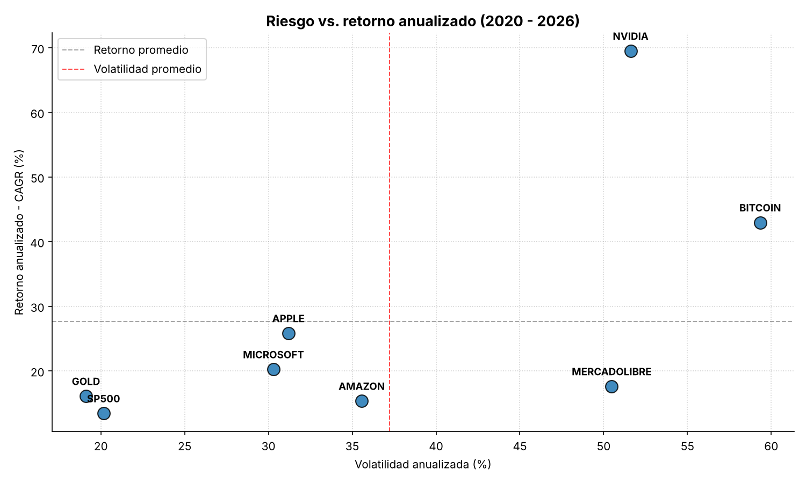
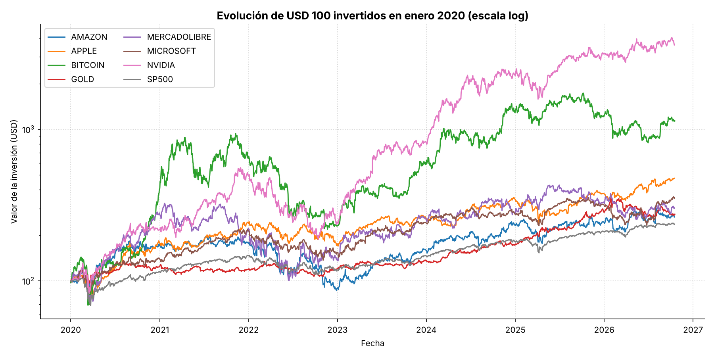
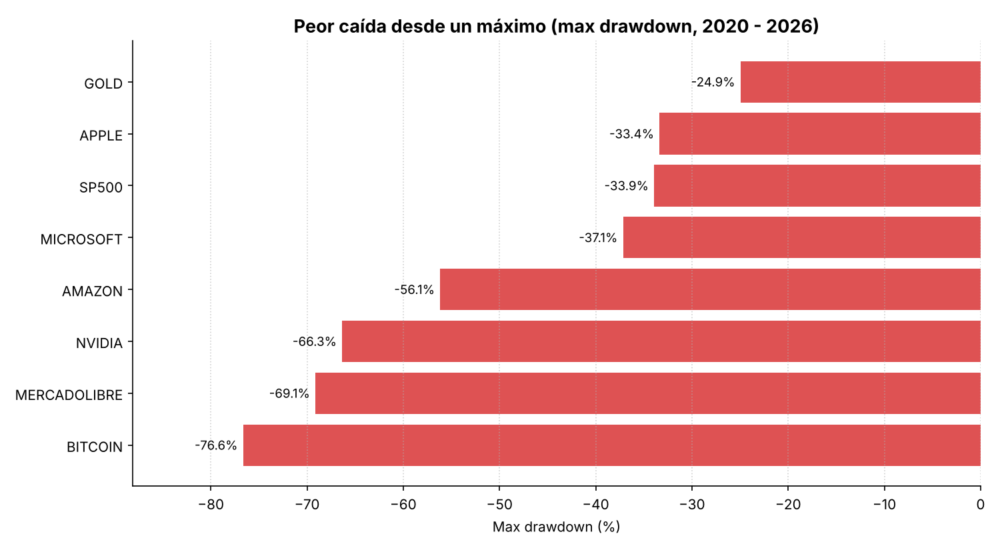
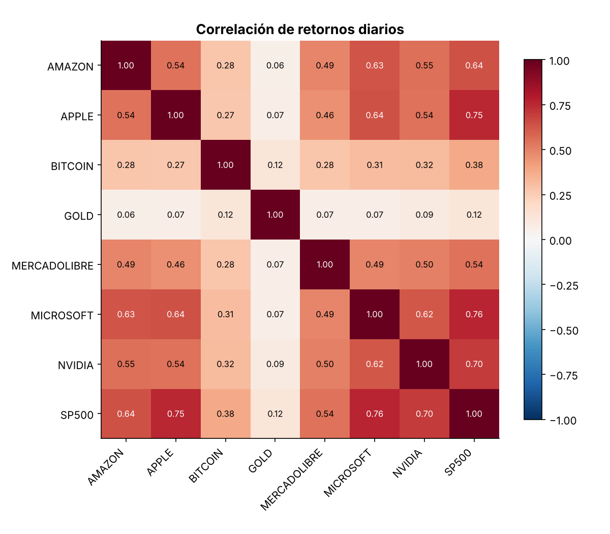

# Análisis de riesgo y retorno: acciones, cripto y oro (2020 - 2026)

Pipeline en Python que descarga precios históricos de 8 activos, los limpia, calcula métricas de riesgo y retorno y genera un ranking, una matriz de correlación y gráficos. El análisis completo, con las conclusiones, está en el [notebook](notebooks/analisis_portafolio.ipynb).

**Pregunta:** si en enero de 2020 hubiera invertido en alguno de estos activos, ¿cuál me habría dado el mejor retorno *por unidad de riesgo*? ¿Conviene diversificar?

**Activos:** S&P 500 · Apple · Microsoft · Amazon · NVIDIA · MercadoLibre · Bitcoin · Oro

## Hallazgos principales

| # | Activo | Retorno anual (CAGR) | Volatilidad anual | Peor caída | Retorno / riesgo |
|---|---|---|---|---|---|
| 1 | NVIDIA | 69,5% | 51,6% | -66,3% | 1,35 |
| 2 | Oro | 16,1% | 19,1% | -24,9% | 0,84 |
| 3 | Apple | 25,8% | 31,2% | -33,4% | 0,83 |
| 4 | Bitcoin | 43,0% | 59,3% | -76,6% | 0,72 |
| 5 | S&P 500 | 13,4% | 20,2% | -33,9% | 0,67 |
| 6 | Microsoft | 20,2% | 30,3% | -37,1% | 0,67 |
| 7 | Amazon | 15,3% | 35,6% | -56,1% | 0,43 |
| 8 | MercadoLibre | 17,6% | 50,5% | -69,1% | 0,35 |

*Datos de enero de 2020 a octubre de 2026.*

1. **Retorno alto no es lo mismo que buena inversión.** Bitcoin y MercadoLibre rindieron mucho, pero tuvieron caídas de casi -70% o más. Medidos por retorno por unidad de riesgo, NVIDIA, el oro y Apple fueron más eficientes.
2. **El oro es el gran diversificador.** Su correlación con el resto es de alrededor de 0,1, y en 2022, cuando todo cayó, fue el único activo que quedó neutro.
3. **Cuatro tecnológicas no son una cartera diversificada.** Su correlación entre sí va de 0,5 a 0,75.
4. **Una cartera equiponderada le ganó al S&P 500** (35% contra 13% anual), aunque con más riesgo. Pero tiene sesgo de selección: sin NVIDIA ni Bitcoin, el retorno baja al 23% anual.

| Riesgo vs. retorno | USD 100 invertidos en 2020 |
|---|---|
|  |  |
| **Peor caída por activo** | **Correlación de retornos** |
|  |  |

## Métricas calculadas

- **Retorno diario y acumulado:** variación porcentual del precio de cierre.
- **CAGR:** retorno anual compuesto, calculado con años calendario reales.
- **Volatilidad anualizada:** desvío de los retornos diarios × √252 (bolsa) o × √365 (cripto).
- **Max drawdown:** la peor caída desde un máximo histórico.
- **Medias móviles de 20 y 50 días** y **volatilidad móvil de 20 días.**
- **Correlación:** calculada sobre las fechas en que operaron todos los activos.

## Estructura

```
├── data/
│   ├── raw/            # CSV descargados de Yahoo Finance (no se suben al repo)
│   └── processed/      # CSV con métricas calculadas (no se suben al repo)
├── notebooks/
│   └── analisis_portafolio.ipynb   # análisis y conclusiones
├── reports/
│   ├── resumen_comparativo.csv     # ranking de activos
│   ├── matriz_correlacion.csv
│   └── figures/                    # gráficos generados
├── src/
│   ├── config.py            # rutas y parámetros
│   ├── download_data.py     # 1. descarga (yfinance)
│   ├── explore_data.py      # 2. EDA inicial
│   ├── analisis_activo.py   # 3. limpieza y métricas por activo
│   ├── comparar_activos.py  # 4. ranking y correlaciones
│   ├── visualizar_datos.py  # 5. gráficos
│   └── main.py              # orquesta todo el pipeline
└── tests/
    └── test_analisis.py     # tests unitarios de las métricas
```

## Cómo ejecutarlo

```bash
pip install -r requirements.txt

python src/main.py --descargar   # descarga datos actualizados y corre todo
python src/main.py --local       # usa los CSV ya descargados

python -m unittest discover -s tests
```

Para agregar un activo, alcanza con sumarlo al diccionario `TICKERS` en `src/download_data.py`. El resto del pipeline lo detecta solo.

## Limitaciones

- No incluye dividendos, comisiones ni impuestos.
- El oro se mide con futuros (`GC=F`).
- El ratio retorno/riesgo no descuenta la tasa libre de riesgo, así que no es un ratio de Sharpe estricto.
- Los activos se eligieron en 2026, así que la muestra tiene sesgo de supervivencia.

## Herramientas

Python · pandas · NumPy · Matplotlib · yfinance · Jupyter · unittest

---
**Bautista Serra Brau** · Estudiante de Ingeniería en Informática (UADE) · [LinkedIn](https://linkedin.com/in/bautista-serra-brau-705269340) · [GitHub](https://github.com/Bautista122123)
